# 栖岸咖啡 Qi'an Coffee

基于 **微信小程序 + Vue3 + Spring Boot + MyBatis + MySQL** 的咖啡馆点单课程项目，覆盖用户点单和管理员维护业务数据的完整流程。

> 项目用于课程学习与功能演示，支付为模拟支付。仓库包含三端源码、17 张表结构、后台与小程序静态图片及门店演示视频。导入数据库并录入业务数据、配置图片目录后即可本地体验。

## 视觉与素材预览

<p align="center">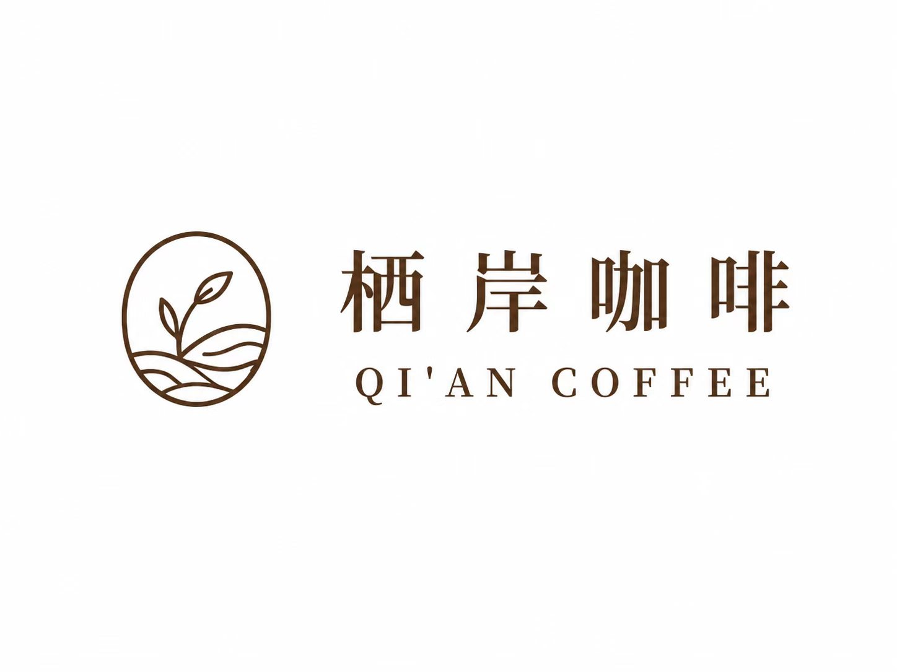</p>

采用咖啡馆主题插画、米色页面背景与绿色交互元素。以下为项目实际使用的图片素材，不是运行截图。

| 招牌拿铁轮播图 | 甜点时光轮播图 | 会员专享轮播图 |
| --- | --- | --- |
|  |  |  |

| 门店插画 | 后台登录页插画 |
| --- | --- |
| 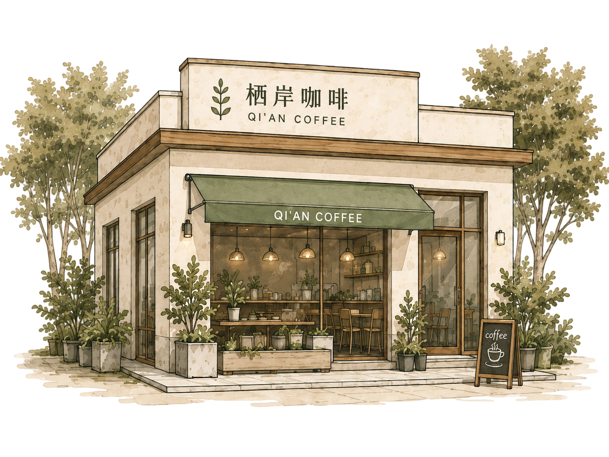 |  |

## 微信小程序部分页面展示

以下选取 7 张微信小程序页面设计效果图，展示项目的部分页面，并非全部页面；实际运行效果以源码为准。

| 首页欢迎页 | 登录注册页 | 功能入口页 |
| --- | --- | --- |
| 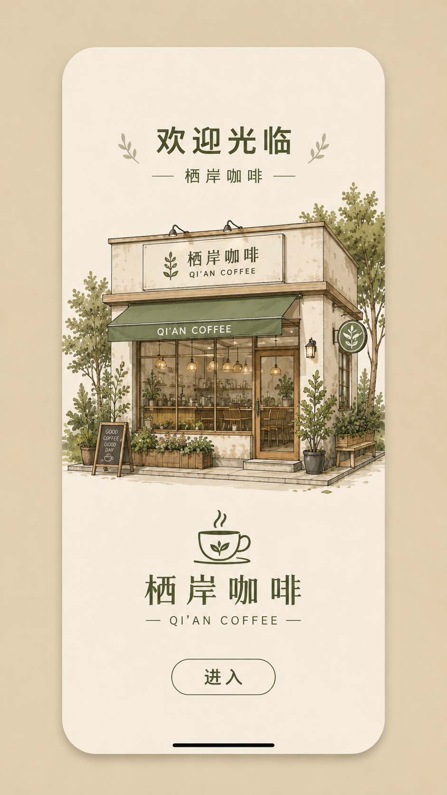 | 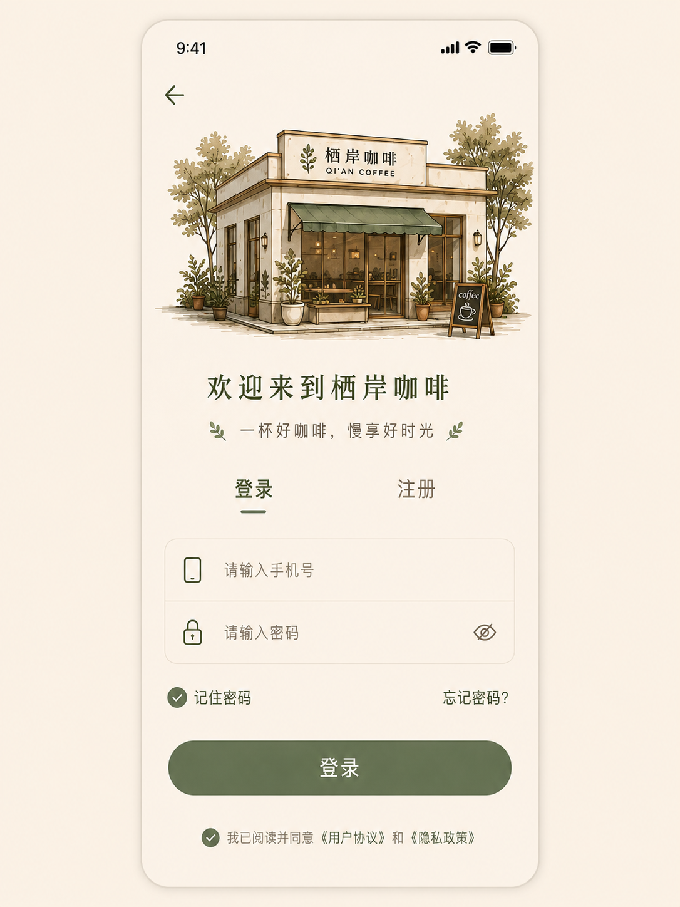 | 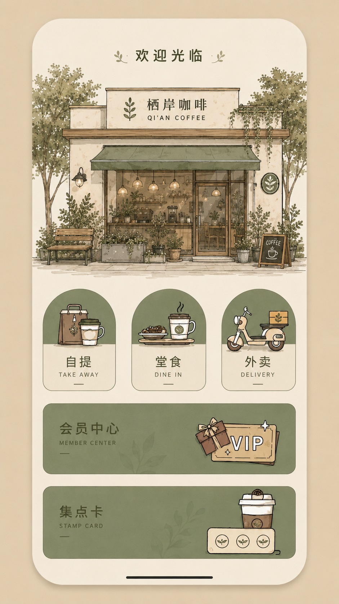 |

| 菜单点单页 | 购物袋页 |
| --- | --- |
| 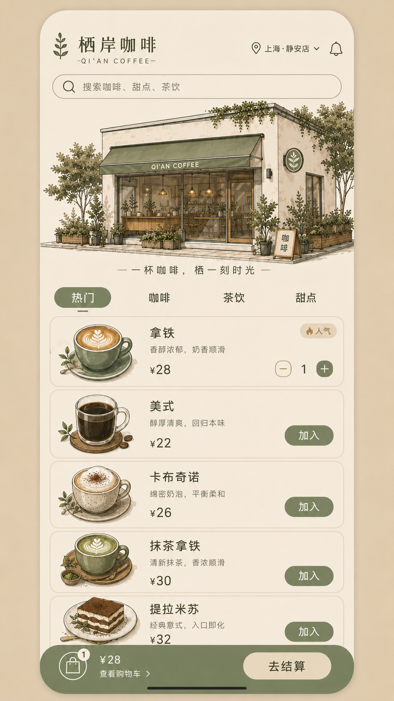 | 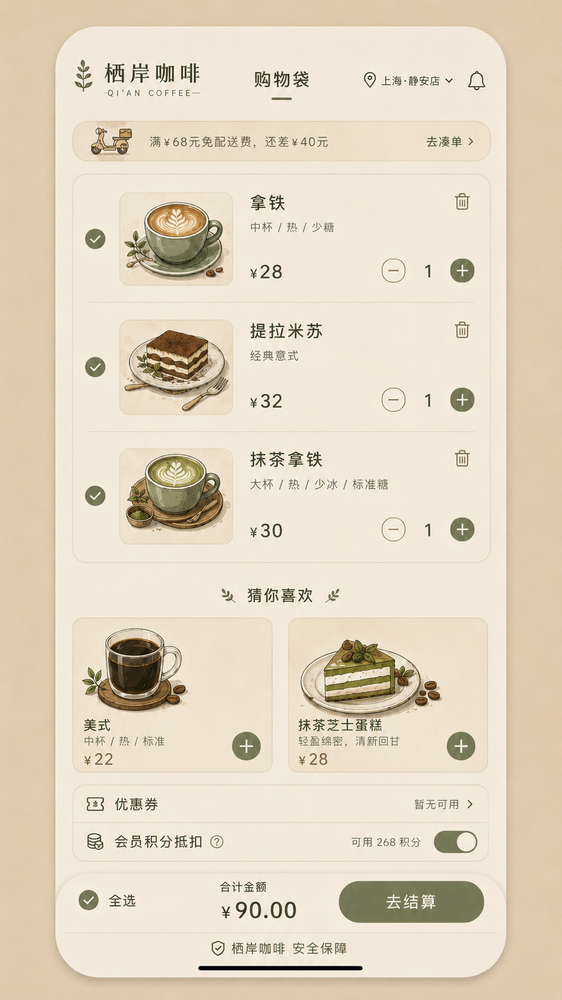 |

| 会员中心页 | 门店详情页 |
| --- | --- |
| 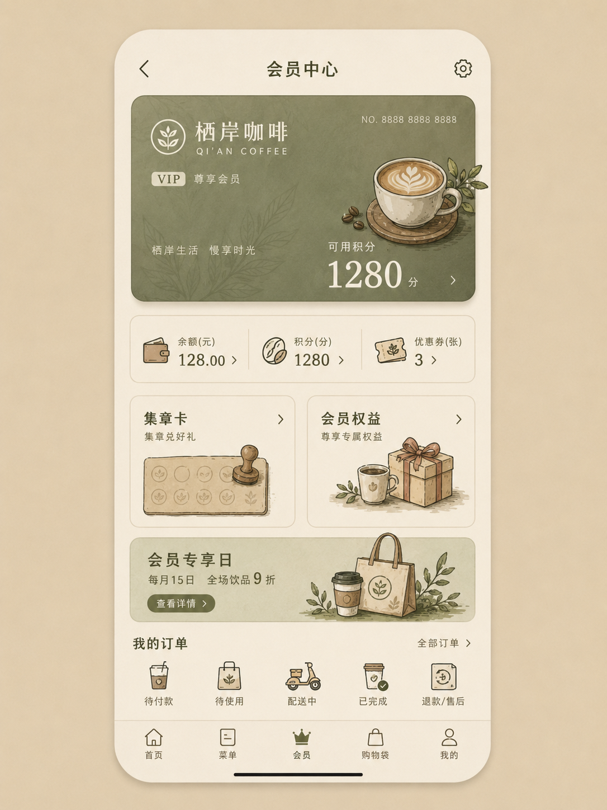 | 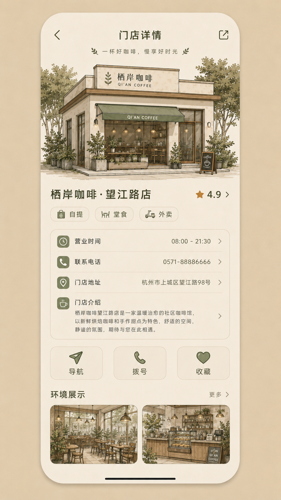 |

## Vue3 后台管理端部分页面展示

以下为后台管理端的 6 张页面设计参考图，仅展示部分页面；图中数据用于效果展示，实际功能与界面以源码运行结果为准。

### 后台登录页

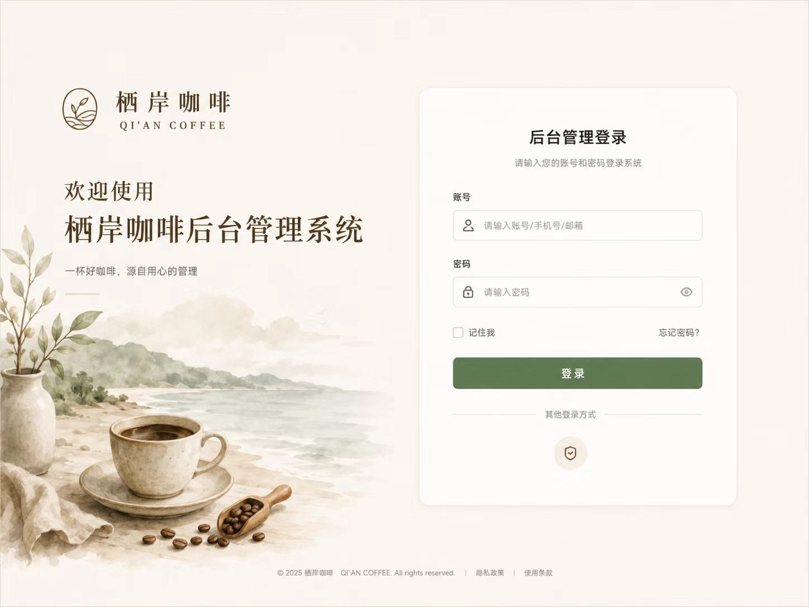

### 数据概览页

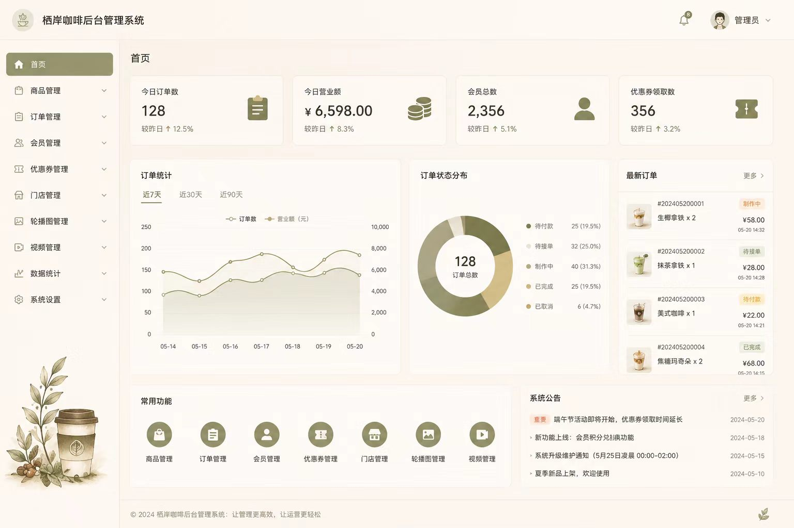

### 商品管理页

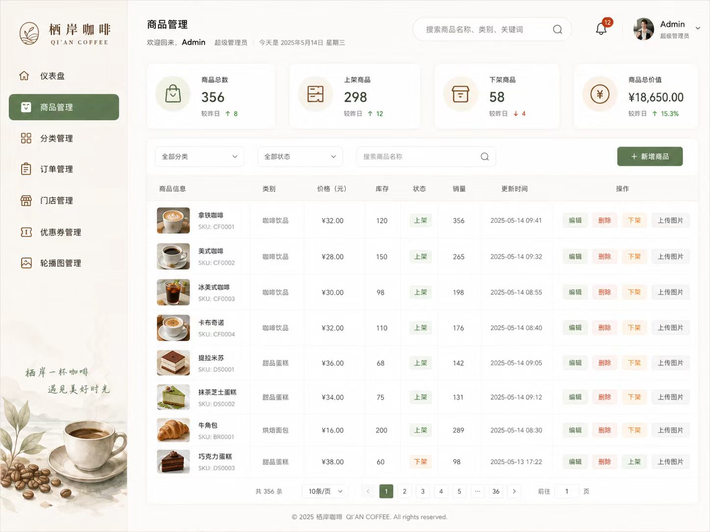

### 分类管理页

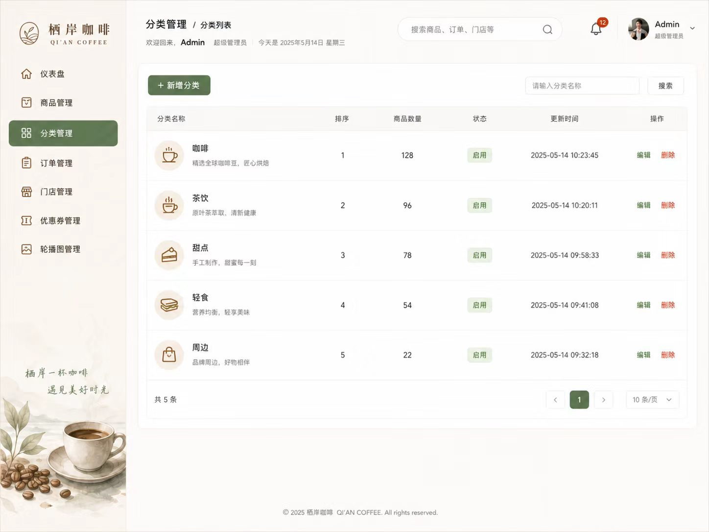

### 订单管理页

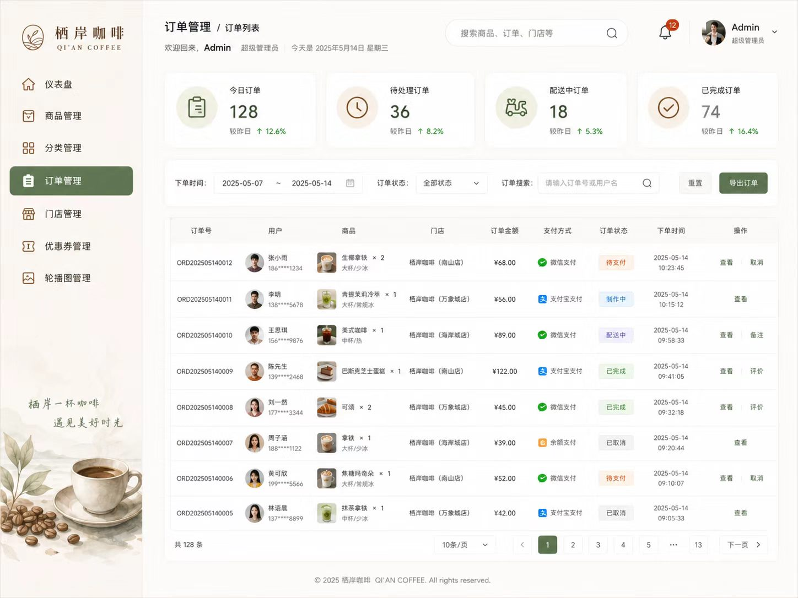

### 门店管理页

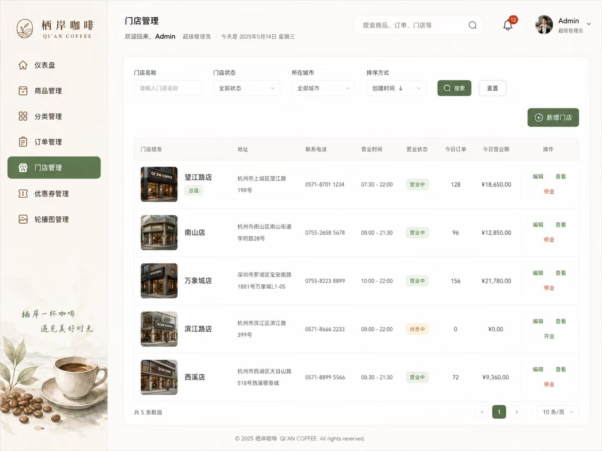

## 功能介绍

### 微信小程序用户端

共 18 个页面：欢迎首页、登录注册、功能入口、菜单点单、搜索、商品详情、购物袋、确认订单、支付成功、我的订单、订单详情、个人中心、会员中心、集点卡、优惠券、地址管理、门店详情、设置。

- 点单：分类浏览、关键词搜索、温度/杯型/糖度/加料选择、数量调整和购物袋同步。
- 订单：填写备注、优惠券与积分抵扣、模拟支付、稍后付款、订单状态筛选和取消订单。
- 会员：头像、昵称、余额、积分、优惠券和集点兑换。
- 页面组件：图片、轮播图、视频、表单、列表、点击事件与页面跳转。

### Vue3 后台管理端

| 模块 | 主要用途 |
| --- | --- |
| 数据概览 | 查看商品、订单、会员等运营数据 |
| 商品管理 | 维护商品图片、价格、库存、状态及规格 |
| 分类与规格 | 维护菜单分类、温度、杯型、糖度和加料 |
| 订单管理 | 查看明细、处理状态和取消订单 |
| 会员管理 | 维护会员资料、积分、余额与集点 |
| 优惠券管理 | 维护优惠类型、门槛和有效期 |
| 集点卡管理 | 管理集点规则、记录和兑换 |
| 门店管理 | 维护地址、电话、营业时间和图片 |
| 轮播图管理 | 管理小程序轮播图 |
| 管理员设置 | 后台设置入口 |

后台通过 Spring Boot 保存业务数据，小程序通过接口读取更新；修改后需刷新相关页面。

## 技术栈

| 端 | 技术 |
| --- | --- |
| 小程序 | WXML、WXSS、JavaScript、原生微信组件 |
| 管理端 | Vue3、Vite、Element Plus 2.4.4、Vue Router、Pinia、Axios |
| 后端 | Spring Boot、MyBatis、Maven |
| 数据库 | MySQL，17 张表 |
| 图片 | Spring Boot 静态资源映射与图片上传接口 |

## 项目目录

```text
xian-coffee/
├── XianCoffee/          微信小程序
├── admin-vue/           Vue3 管理端
├── XianCoffeebackend/    Spring Boot 后端
├── uploads/images/     后台、小程序静态素材与演示视频
├── sql/schema.sql      数据库表结构
├── README.md           项目说明
├── LICENSE             源码 MIT 许可证
└── .gitignore          文件忽略规则
```

## 本地运行

### 1. 准备环境

安装 MySQL、Node.js 和项目 pom.xml 对应版本的 JDK，并准备 Maven、微信开发者工具。
前端当前锁定依赖中的 Vite 8 要求 Node.js 20.19+ 或 22.12+，建议使用兼容版本。

### 2. 初始化数据库

使用 DataGrip 或其他 MySQL 客户端执行 `sql/schema.sql`。

脚本会创建 `xian_coffee` 数据库和 17 张表，**不含真实会员、地址、订单或密码数据，也没有业务种子数据**。分类、商品、门店和轮播图需通过后台录入后展示。

### 3. 启动 Spring Boot

使用 IntelliJ IDEA 打开 `XianCoffeebackend`，下载 Maven 依赖，在运行配置中设置：

```text
DB_USERNAME=你的MySQL用户名
DB_PASSWORD=你的MySQL密码
```

按实际环境调整 `src/main/resources/application.yml` 中的数据库连接地址，启动 `XiAnCoffeebackendApplication`。

默认服务端口：`2544`；API 基础路径：`http://localhost:2544/api`。

### 4. 启动 Vue3 管理端

```bash
cd admin-vue
npm ci
npm run dev
```

打开终端输出的访问地址，默认通常为 `http://localhost:5173`。

公开版将原有教学密码替换为 `CHANGE_ME_BEFORE_RUN`。请在 `src/api/adminApi.js` 和登录表单相关配置中设置自己的演示密码。当前认证实现仅供教学，生产部署需增加后端鉴权和密码哈希。

打包命令：

```bash
npm run build
```

### 5. 打开微信小程序

微信开发者工具导入 `XianCoffee`，在项目设置中配置自己的 AppID。仓库里的 `touristappid` 是占位值。

后端默认地址为 `http://localhost:2544`。手机不能通过 localhost 访问电脑，真机调试时应同步修改接口地址和页面图片地址，使用手机可访问的主机地址；正式发布需配置 HTTPS 服务及合法域名。

## 图片目录与访问方式

原项目运行所需的静态素材目录为：

```text
uploads/images/
├── admin/          后台商品、门店、轮播图等静态素材
└── miniprogram/    小程序页面图片、图标、插图
```

用户运行时上传的图片保存到 `uploads/images`，与两个静态素材子目录并存。公开仓库应包含静态素材，排除真实用户上传文件。

后端配置：

```yaml
xian-coffee:
  upload:
    image-path: D:/XianCoffee/uploads/images
    image-url-prefix: /images/
```

换电脑后请将 `image-path` 改成实际的绝对目录。访问示例：

```text
http://localhost:2544/images/miniprogram/menu/latte.png
http://localhost:2544/images/admin/banner/banner-latte.jpg
```

**已提供 246 个静态素材文件（含两份门店演示视频路径），并补齐 Vue 管理端的 18 个 public 静态图片。** 文件位于上述目录，保持原项目相对路径。真实用户上传的图片不随仓库发布。

## 建议体验流程

1. 配置数据库和图片目录，启动后端。
2. 登录后台，录入分类、规格、商品和门店。
3. 打开小程序注册用户并登录。
4. 选择商品规格，加入购物袋，选择优惠并提交订单。
5. 选择立即支付或稍后付款，查看订单。
6. 在后台查看订单和会员数据，再回到小程序刷新核对。

## 常见问题

**页面没图：** 检查素材是否存在、后端是否启动、图片 URL 能否打开，以及 `image-path` 是否指向正确目录。

**列表为空：** 当前 SQL 只有表结构，需要先录入业务数据。

**手机无法请求：** 检查是否仍在使用 localhost，以及手机与电脑间的网络是否可达。

**后台修改后小程序未变化：** 刷新页面，并确认两端使用同一个后端服务。

## 开源说明

源码使用 [MIT License](LICENSE)。第三方依赖保留各自许可证。图片和视频的使用权需按素材来源确认，源码 MIT 授权不代表对所有素材授予同等授权。

数据库密码、真实用户上传文件、会员和订单数据不公开。本次仓库整理未执行完整构建与真机回归测试。
